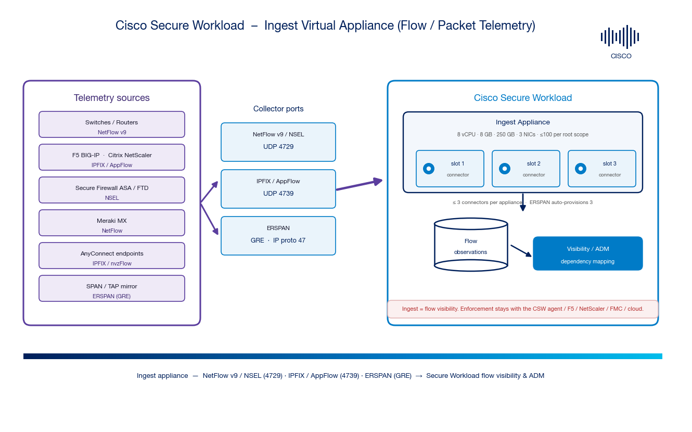

# Cisco Secure Workload → Ingest Virtual Appliance & Ingest Connectors Integration Guide

A step-by-step, **beginner-friendly** guide to deploying the **Cisco Secure Workload (CSW) Ingest virtual appliance** and its **flow / packet** connectors — **NetFlow v9**, **IPFIX / AppFlow** (F5, Citrix NetScaler, AnyConnect), **NSEL** (Secure Firewall ASA/FTD, Meraki), and **ERSPAN** — so CSW gains east-west visibility from network devices without a software agent on every host.

> **⚠ Disclaimer:** This is a **community reference guide** prepared by Cisco Solutions Engineering — not an official Cisco product document. Always refer to the [official Cisco Secure Workload documentation](https://www.cisco.com/c/en/us/support/security/tetration/series.html), the **Connectors** chapter of the [Configure and Manage Connectors user guide](https://www.cisco.com/c/en/us/td/docs/security/workload_security/secure_workload/user-guide/4_0/cisco-secure-workload-user-guide-saas-v40/m-connectors.html), and the [Compatibility Matrix](https://www.cisco.com/c/m/en_us/products/security/secure-workload-compatibility-matrix.html) for authoritative, up-to-date guidance.

---

## 0. New to CSW virtual appliances? Read this first (2 minutes)

- **Cisco Secure Workload (CSW)** discovers how workloads talk and builds **least-privilege micro-segmentation** using **labels → scopes → policies**.
- CSW has **two** virtual-appliance types:
  - **Secure Workload Ingest** — a **flow/packet** appliance. Its connectors **listen on ports** and export **flow observations** to the cluster. *(this guide)*
  - **Secure Workload Edge** — a **control appliance** for label enrichment + alerting. See the [Edge connector guide](https://github.com/chandrapati/csw-edge-connector).
- Ingest connectors let switches, firewalls, load balancers, and mirror sessions relay flow/packet telemetry so hosts **avoid running a software agent**.

**Why deploy Ingest connectors?**

| Problem | What the Ingest connector gives you |
|---|---|
| Hosts/devices can't run a CSW agent (appliances, unmanaged, network gear) | Devices **export flow records**; the connector collects them and feeds CSW visibility/ADM |
| You already export **NetFlow/IPFIX/NSEL** to a collector | Point that export at an Ingest connector slot — CSW becomes the collector |
| You need east-west visibility from **SPAN/TAP** | **ERSPAN** connectors reconstruct flows from mirrored packets |
| Load balancers hide the real client/server | **F5** and **NetScaler** connectors **stitch NATed** flows |

> **Important scope note:** Ingest provides **flow visibility** (for the dependency map, ADM, and policy discovery) — **not** label enrichment (use **Edge**) and **not** enforcement (use the **CSW agent** or enforcement orchestrators F5 / NetScaler / FMC / cloud).

---

## 1. Architecture

*Telemetry sources export to collector ports on the Ingest appliance: **NetFlow v9 / NSEL → UDP 4729**, **IPFIX / AppFlow → UDP 4739**, **ERSPAN → GRE (IP protocol 47)**. Each connector occupies a **slot** (an IP/port binding); the appliance holds up to **3 connectors** (ERSPAN auto-provisions 3). The connectors export **flow observations** to the Secure Workload cluster for visibility and Application Dependency Mapping (ADM).*

| Path | Direction | Transport | Purpose |
|---|---|---|---|
| **Flow export** | Device → connector slot | NetFlow v9 / NSEL (UDP 4729), IPFIX / AppFlow (UDP 4739) | Deliver flow records |
| **Packet mirror** | SPAN/TAP → ERSPAN connector | GRE-encapsulated mirrored packets (IP proto 47) | Reconstruct flows from packets |
| **Connector → cluster** | Ingest appliance → CSW cluster | CSW data plane (TLS) | Export flow observations |

---

## 2. Connectors that run on the Ingest appliance

| Connector | Source | Protocol | Default port | Notes |
|---|---|---|---|---|
| **NetFlow** | switches/routers | NetFlow v9 | UDP **4729** | generic NetFlow v9 collector |
| **F5** | F5 BIG-IP | IPFIX | UDP **4739** | stitches NATed client/server flows |
| **NetScaler** | Citrix ADC | AppFlow (IPFIX) | UDP **4739** | stitches NATed flows; registers as a CSW agent |
| **Secure Firewall (ASA)** | ASA / FTD | NSEL (NetFlow) | UDP **4729** (example) | handles NSEL events; stitches NAT |
| **Meraki** | Meraki MX / APs | NetFlow | UDP **4729** | NetFlow from Meraki firewalls |
| **AnyConnect** | endpoints (NVM) | IPFIX / nvzFlow | UDP **4739** | endpoint flow + user/process — see [csw-anyconnect-nvm](https://github.com/chandrapati/csw-anyconnect-nvm) |
| **ERSPAN** | SPAN/TAP mirror | ERSPAN (GRE) | IP proto **47** | 3 connectors auto-provisioned; each gets 1 vNIC + 2 vCPU |

> **Slots:** each non-ERSPAN connector binds to one appliance IP/port = one **slot**. Enabling a connector takes a slot; disabling it frees the slot. Up to **3** connectors per appliance.

---

## 3. Prerequisites

**Appliance host (ESXi / KVM):**

| Resource | Requirement |
|---|---|
| vCPU | **8 cores** reserved |
| Memory | **8 GB (8192 MB)** reserved |
| Storage | **250 GB** |
| Network interfaces | **3** |
| OS (bundled in OVA/QCOW2) | AlmaLinux 9.2 (CSW 3.8.1.36+) / CentOS 7.9 (earlier) |
| Limits | **≤ 3 connectors** per appliance · **≤ 100 Ingest appliances** per root scope |

**Network & devices:**

- Reachability from each exporting device to the connector's **slot IP** on the correct **UDP port** (4729 / 4739), or a **GRE** path for ERSPAN.
- Outbound **TLS** from the appliance to the CSW cluster (SaaS or on-prem). Across networks, front with the **[Secure Connector](https://github.com/chandrapati/csw-secure-connector)** tunnel where applicable.
- **NTP** and **DNS** reachable.
- ERSPAN: a SPAN/RSPAN/ERSPAN source configured on the switch pointed at the ERSPAN connector's interface. Choose the mirrored VLAN/port set carefully — each ERSPAN connector has only 2 dedicated vCPUs and can drop packets if oversubscribed (watch the **Agent Packet Misses** graph).

---

## 4. Deploy the Ingest appliance

1. **Manage → Connectors** → pick an ingest connector (e.g., **NetFlow**) → **Enable**.
2. When prompted **"Deploy a virtual appliance"**, click **Yes** → choose **Secure Workload Ingest**. (Reuse an existing Ingest appliance in the scope if one has a free slot.)
3. Configure VM parameters — hostname, **three** network interfaces (one per slot IP as needed), netmask/gateway, DNS, NTP, proxy, VRF/scope. Reserve **8 vCPU / 8192 MB / 250 GB**.
4. Download the **VM configuration bundle**; deploy the **OVA/QCOW2** and attach the bundle.
5. Power on. Watch status transition **Pending Registration → Active** under **Manage → Virtual Appliances**.

> For an **ERSPAN** appliance, three ERSPAN connectors are provisioned automatically (same OVA/QCOW2). Reserve the full 8 vCPU/8192 MB or the setup script fails after boot.

---

## 5. Enable & configure a flow connector

Example — **NetFlow**:

1. **Manage → Connectors → NetFlow → Enable** (on the Ingest appliance). A **slot IP** is assigned; note the **listening IP:port** (default UDP **4729**).
2. On the exporting device, set the **NetFlow v9 collector** to that IP:port and pick the template/version and export interval.
3. Save. Within a minute or two, flows appear on the connector page and in the **Flows** explorer.

Example — **F5 / NetScaler (IPFIX/AppFlow)**:

1. Enable the **F5** (or **NetScaler**) connector; note the slot IP:port (default UDP **4739**).
2. On the F5, create the **IPFIX pool** pointing to the connector IP(s); on NetScaler configure the **AppFlow collector** to the connector IP:port.
3. Save; the connector stitches NATed flows and exports observations.

Example — **ERSPAN**:

1. The ERSPAN appliance auto-provisions **3 ERSPAN connectors** (one per interface/slot).
2. On the switch, configure an **ERSPAN source** session mirroring the target VLAN/ports to the connector interface's IP (GRE).
3. Verify packets are arriving and not being dropped (**Agent Packet Misses**).

> **Changing ports:** IPFIX/NetFlow listening ports can be changed on the connector's Docker container using the appliance's `update-listening-ports` allowed command with the **connector ID** (from the connector page).

---

## 6. Verify

- **Appliance health:** **Manage → Virtual Appliances** → Ingest appliance **Active**; CPU/Mem/Disk < 90%.
- **Connector health:** **Manage → Connectors** → connector shows **Active** with a recent heartbeat and non-zero received records.
- **Flows landing:** open **Investigate → Flows** (or the connector's stats) and confirm flows tagged from the exporter appear.
- **ERSPAN:** confirm the **Agent Packet Misses** graph is ~0; if not, reduce the mirrored scope.
- **NAT stitching (F5/NetScaler/ASA):** spot-check that client↔VIP↔server flows are stitched into a single observation.

---

## 7. Caveats & gotchas

- **≤ 3 connectors per Ingest appliance.** Add more appliances (up to 100/root scope) to scale; multiple instances of the same connector type are allowed.
- **Ingest ≠ Edge.** Ingest takes flow/packet telemetry and **listens on ports**; Edge does labels/alerts and **doesn't**. Don't point ServiceNow/ISE at Ingest.
- **ERSPAN sizing.** Each ERSPAN connector has 2 dedicated vCPUs; oversubscribed SPAN sessions drop packets. Trim the VLAN/port list.
- **"Secure Firewall Connector"** (formerly ASA) ingests **NSEL** on an Ingest appliance — it is **not** the FMC policy-push integration and **not** the Secure Connector tunnel.
- **Port collisions.** Two IPFIX connectors both default to 4739 — put them on different slot IPs or change the port via `update-listening-ports`.
- **Redeploy to patch.** Pick up OS/package updates by **redeploying** from the latest Ingest OVA — not in place.
- **Time sync.** Registration fails without correct NTP.

---

## 8. Related videos & learning

- **Secure Workload — Connectors overview** (YouTube search): <https://www.youtube.com/results?search_query=cisco+secure+workload+connectors>
- **NetFlow / ERSPAN ingestion** (YouTube search): <https://www.youtube.com/results?search_query=cisco+secure+workload+netflow+erspan+connector>
- **Cisco Secure playlist:** <https://www.youtube.com/@CiscoSecure>

*(Links are searches/playlists so they stay valid as Cisco refreshes content.)*

---

## 9. Official references

See [`docs/00-official-references.md`](docs/00-official-references.md). Key links:

- **Configure and Manage Connectors (4.0):** <https://www.cisco.com/c/en/us/td/docs/security/workload_security/secure_workload/user-guide/4_0/cisco-secure-workload-user-guide-saas-v40/m-connectors.html>
- **Compatibility Matrix:** <https://www.cisco.com/c/m/en_us/products/security/secure-workload-compatibility-matrix.html>
- **Secure Workload product docs:** <https://www.cisco.com/c/en/us/support/security/tetration/series.html>

---

## 10. Where this fits in the connector family

| Appliance / mechanism | Repo | Use it for |
|---|---|---|
| **Ingest appliance** | **this repo** | Flow/packet ingest: NetFlow v9, IPFIX/AppFlow, NSEL, ERSPAN |
| **Edge appliance** | [csw-edge-connector](https://github.com/chandrapati/csw-edge-connector) | Context enrichment (ISE/AD/ServiceNow) + alert notifications |
| **Secure Connector tunnel** | [csw-secure-connector](https://github.com/chandrapati/csw-secure-connector) | On-prem proxy for private orchestrator APIs (SaaS) |

---

*Community reference guide · Cisco Solutions Engineering · anonymized, no customer data.*
