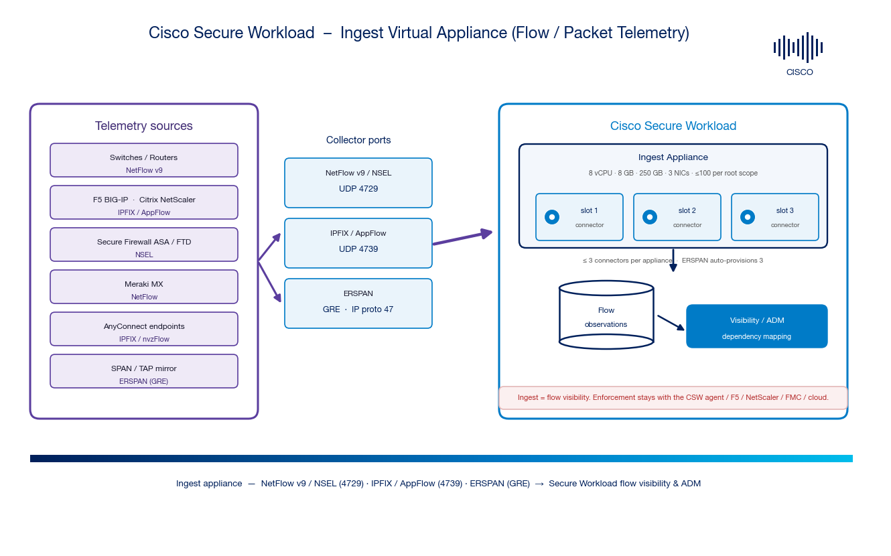

# Cisco Secure Workload — Ingest Virtual Appliance & Ingest Connectors

> **Disclaimer:** Community reference guide by Cisco Solutions Engineering. Always consult the [official Cisco Secure Workload documentation](https://www.cisco.com/c/en/us/support/security/tetration/series.html) and the **Connectors** chapter of the [Configure and Manage Connectors (4.0)](https://www.cisco.com/c/en/us/td/docs/security/workload_security/secure_workload/user-guide/4_0/cisco-secure-workload-user-guide-saas-v40/m-connectors.html) user guide for authoritative guidance.

The **Secure Workload Ingest** appliance collects **flow / packet telemetry** and exports **flow observations** to the CSW cluster — so network devices feed east-west visibility without a software agent on every host. It hosts these connectors:

- **NetFlow v9** (switches/routers) · **Secure Firewall/ASA NSEL** · **Meraki** → UDP **4729**
- **F5 / NetScaler / AnyConnect** (IPFIX / AppFlow / nvzFlow) → UDP **4739**
- **ERSPAN** (SPAN/TAP mirror) → **GRE** (IP proto 47); 3 connectors auto-provisioned

---

## Architecture

*Sources export NetFlow/IPFIX/NSEL/ERSPAN to connector **slots** on the Ingest appliance, which forwards **flow observations** to the cluster for visibility & ADM.*

---

## Contents

| File | Description |
|------|-------------|
| [`CSW-Ingest-Connector-Integration-Guide.md`](./CSW-Ingest-Connector-Integration-Guide.md) | Full step-by-step guide (Markdown) |
| [`csw-ingest-architecture.png`](./csw-ingest-architecture.png) | Architecture diagram |
| [`make_architecture.py`](./make_architecture.py) | Regenerate the diagram (matplotlib) |
| [`docs/00-official-references.md`](./docs/00-official-references.md) | Canonical Cisco doc links |
| [`docs/CUSTOMER-HANDOFF.md`](./docs/CUSTOMER-HANDOFF.md) | Customer-facing deployment checklist |
| [`build.sh`](./build.sh) | Rebuild HTML/PDF from Markdown |

---

## Quick start (5 steps)

1. **Deploy the appliance** — **Manage → Connectors** → enable an ingest connector (e.g., **NetFlow**) → when prompted, deploy a **Secure Workload Ingest** VM (8 vCPU / 8 GB / 250 GB, **3 NICs**).
2. **Register** — power on; watch **Pending Registration → Active** under **Manage → Virtual Appliances**.
3. **Note the slot IP:port** — NetFlow/NSEL/Meraki → UDP **4729**; F5/NetScaler/AnyConnect → UDP **4739**; ERSPAN → GRE.
4. **Point the exporter** — configure the device's NetFlow/IPFIX/AppFlow collector (or SPAN/ERSPAN source) to the connector.
5. **Verify** — connector heartbeat green + non-zero records; flows visible in **Investigate → Flows**; ERSPAN **Packet Misses** ~0.

---

## What Ingest is (and is not)

| Ingest appliance **is** | Ingest appliance **is not** |
|---|---|
| A **flow/packet** collector (NetFlow, IPFIX, NSEL, ERSPAN) | A **label/alert** appliance (that's **Edge**) |
| Connectors that **listen on ports** (slots) | A **policy enforcement** point (agent / F5 / NetScaler / FMC / cloud) |
| **≤ 3 connectors** each · **≤ 100** per root scope | The **Secure Connector** tunnel (Linux RPM) |
| NAT-stitching for F5 / NetScaler / ASA | A replacement for CSW agents |

---

## The CSW virtual-appliance / connector family

| Appliance / mechanism | Repo | Best for |
|---|---|---|
| **Ingest appliance** | **this repo** | NetFlow v9, IPFIX/AppFlow, NSEL, ERSPAN flow ingest |
| **Edge appliance** | [csw-edge-connector](https://github.com/chandrapati/csw-edge-connector) | ISE/AD/ServiceNow labels + Syslog/Email/Slack/PagerDuty/Kinesis alerts |
| **Secure Connector tunnel** | [csw-secure-connector](https://github.com/chandrapati/csw-secure-connector) | On-prem proxy for private orchestrator APIs (SaaS) |
| [AnyConnect NVM](https://github.com/chandrapati/csw-anyconnect-nvm) | endpoint | Endpoint flow visibility via NVM (runs on Ingest) |
| [vCenter](https://github.com/chandrapati/csw-vcenter-integration) · [F5](https://github.com/chandrapati/csw-f5-integration) · [NetScaler](https://github.com/chandrapati/csw-netscaler-integration) · [Infoblox](https://github.com/chandrapati/csw-infoblox-integration) | orchestrators | Label import (and, where supported, enforcement) |
| [User Education](https://github.com/chandrapati/CSW-User-Education) | onboarding | Start here if you're new to CSW |

---

## Step-by-Step Guides

| Guide | Repo |
|-------|------|
| Ingest appliance (flow/packet) | **this repo** |
| Edge appliance (enrichment + alerts) | [csw-edge-connector](https://github.com/chandrapati/csw-edge-connector) |
| Secure Connector (SaaS tunnel) | [csw-secure-connector](https://github.com/chandrapati/csw-secure-connector) |
| AnyConnect NVM (endpoints) | [csw-anyconnect-nvm](https://github.com/chandrapati/csw-anyconnect-nvm) |
| VMware vCenter (labels) | [csw-vcenter-integration](https://github.com/chandrapati/csw-vcenter-integration) |
| F5 BIG-IP | [csw-f5-integration](https://github.com/chandrapati/csw-f5-integration) |
| Citrix NetScaler | [csw-netscaler-integration](https://github.com/chandrapati/csw-netscaler-integration) |
| Infoblox | [csw-infoblox-integration](https://github.com/chandrapati/csw-infoblox-integration) |

---

*Community reference guide · Cisco Solutions Engineering · anonymized, no customer data.*
